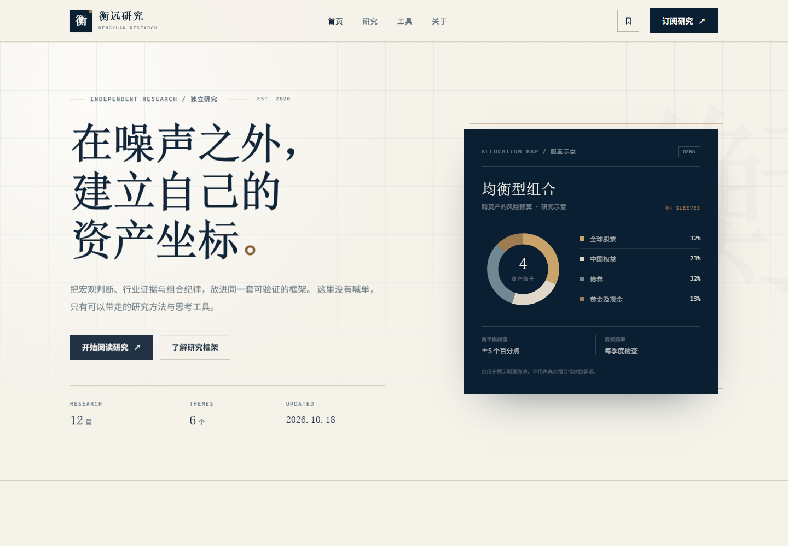

# 衡远研究 · HENGYUAN RESEARCH

一个面向个人投资者的**纯前端投资研究网站 MVP**。内容围绕资产配置、行业研究与组合纪律，提供研究阅读、前端搜索、收藏、订阅意向登记与两个实用计算器。

> 项目定位：可部署的静态内容站 + 少量 React 交互岛。无后端、无数据库、无真实登录/支付/邮件/行情/评论，也不包含任何密钥。

**线上站点：<https://fovlucky-heng.github.io/>**



---

## 1. 快速开始

环境要求：

- Node.js **>= 22.12.0**（建议 Node 24 LTS）
- npm **>= 9.6.5**

```bash
npm install
npm run dev
# 默认 http://localhost:4321
```

生产构建与本地预览：

```bash
npm run build
npm run preview
# 默认 http://localhost:4321
```

类型检查：

```bash
npm run check
```

生成封面与 OG 图片（可选，仅在修改 `scripts/generate_assets.py` 后需要）：

```bash
python scripts/generate_assets.py
```

> 站点运行和构建不依赖 Python。图片已经预生成并放在 `public/images/`。该脚本使用 Pillow，字体路径默认面向 Windows；非 Windows 环境如需重新生成，请替换脚本中的字体路径。

---

## 2. 路由与页面清单

| 路由 | 页面 | 渲染方式 | 说明 |
| --- | --- | --- | --- |
| `/` | 首页 | Astro 静态 | Hero、最新研究、研究框架、6 个主题分类、订阅 CTA |
| `/research/` | 研究档案 | Astro + React 岛 | Fuse.js 搜索、主题/标签筛选、排序、前端分页、空状态 |
| `/research/<slug>/` | 研究详情 | Astro 静态，共 12 篇 | Markdown 渲染、TOC、作者/日期、收藏、风险提示、相关推荐 |
| `/about/` | 关于 | Astro 静态 | 专家背景、研究方法、四层研究框架、研究原则 |
| `/subscribe/` | 订阅/联系 | Astro + React 岛 | 姓名/邮箱/兴趣方向、前端校验、模拟提交成功 |
| `/favorites/` | 我的收藏 | Astro + React 岛 | localStorage 收藏列表、移除、清空；`noindex` |
| `/tools/` | 投资工具 | Astro + React 岛 | 复利计算器、定投计算器、实时校验、演示声明 |
| `/404.html` | 404 | Astro 静态 | 自定义未找到页面；Vercel/Netlify 自动使用 |
| `/sitemap.xml` | Sitemap | Astro 静态端点 | 首页、研究档案、关于、订阅、工具与全部文章 |
| `/rss.xml` | RSS 2.0 | Astro 静态端点 | 文章标题、摘要、日期、分类 |
| `/robots.txt` | Robots | Astro 静态端点 | 指向 sitemap，排除收藏页 |

所有内部链接使用尾部斜杠，与 `trailingSlash: 'always'` 和 `build.format: 'directory'` 保持一致。

---

## 3. 目录结构

```text
hengyuan-research/
├── astro.config.mjs             # Astro / React / MDX / Tailwind 配置
├── package.json
├── package-lock.json
├── tsconfig.json
├── vercel.json                  # Vercel 静态部署 + 安全/缓存响应头
├── netlify.toml                 # Netlify 构建与响应头
├── .nvmrc                       # Node 24
├── .github/workflows/
│   └── deploy-pages.yml         # GitHub Pages 构建与部署
├── docs/
│   └── preview-home.png         # README 首页预览
├── public/
│   ├── .nojekyll                # 避免 GitHub Pages 走 Jekyll
│   ├── favicon.svg
│   └── images/
│       ├── og-default.jpg       # 默认 1200×630 OG 图
│       └── covers/              # 12 张 1600×1000 编辑封面
├── scripts/
│   └── generate_assets.py       # 可选的本地封面生成脚本
└── src/
    ├── components/
    │   ├── calculators/
    │   │   ├── CompoundCalculator.tsx
    │   │   ├── DcaCalculator.tsx
    │   │   ├── NumberField.tsx
    │   │   └── ResultBreakdown.tsx
    │   ├── ArticleCard.astro
    │   ├── Breadcrumbs.astro
    │   ├── CalculatorTabs.tsx
    │   ├── FavoriteButton.tsx
    │   ├── FavoritesList.tsx
    │   ├── Footer.astro
    │   ├── Header.astro
    │   ├── ResearchExplorer.tsx
    │   ├── RiskNotice.astro
    │   ├── SectionHeading.astro
    │   └── SubscribeForm.tsx
    ├── content/
    │   └── articles/            # 12 篇示例 Markdown
    ├── layouts/
    │   └── BaseLayout.astro     # HTML 骨架、SEO、OG、JSON-LD
    ├── lib/
    │   ├── articles.ts          # 内容查询、排序、相关推荐
    │   ├── calculators.ts       # 纯函数计算逻辑
    │   ├── favorites.ts         # localStorage 收藏 store
    │   ├── format.ts            # 日期/货币/百分比格式化
    │   ├── site.ts              # 站点、作者、主题、导航配置
    │   └── xml.ts               # XML 转义
    ├── pages/
    │   ├── research/
    │   │   ├── index.astro
    │   │   └── [slug].astro
    │   ├── 404.astro
    │   ├── about.astro
    │   ├── favorites.astro
    │   ├── index.astro
    │   ├── robots.txt.ts
    │   ├── rss.xml.ts
    │   ├── sitemap.xml.ts
    │   ├── subscribe.astro
    │   └── tools.astro
    ├── styles/
    │   └── global.css           # Tailwind v4 主题、排版、组件样式
    └── content.config.ts        # 内容集合与 frontmatter 校验
```

---

## 4. 内容数据结构

文章放在 `src/content/articles/`，支持 `.md` 与 `.mdx`。frontmatter 由 `src/content.config.ts` 的 Zod schema 在构建时校验：

```yaml
---
title: "2026 资产配置框架：在低增长与高波动之间"
description: "当宏观波动成为常态，资产配置的重点应从“预测方向”转向“管理脆弱性”。"
slug: "asset-allocation-framework"
date: 2026-10-18
author: "林知远"
tags: ["资产配置", "宏观", "再平衡", "风险预算"]
category: "资产配置"
readingTime: 12
cover: "/images/covers/asset-allocation.jpg"
draft: false
---
```

| 字段 | 类型 | 规则 |
| --- | --- | --- |
| `title` | string | 必填 |
| `description` | string | 10–220 字符，用于摘要与 meta description |
| `slug` | string | 小写字母/数字/连字符；同时决定静态路由 |
| `date` | date | 构建时转为 Date，按日期排序 |
| `author` | string | 必填 |
| `tags` | string[] | 1–6 个，参与搜索与筛选 |
| `category` | enum | 资产配置 / 行业研究 / 大类资产 / 组合管理 / 研究方法 / 宏观策略 |
| `readingTime` | number | 正整数，人工维护的阅读分钟数 |
| `cover` | string | 以 `/` 开头的 public 路径 |
| `draft` | boolean | `true` 时在构建阶段排除，不生成路由 |

示例文章覆盖 6 个主题：

- 资产配置：2026 配置框架
- 行业研究：AI 基础设施、供应链、消费品牌、半导体周期
- 大类资产：黄金、债券久期
- 组合管理：再平衡、回撤预算
- 研究方法：财报阅读、估值概率分布
- 宏观策略：美元与新兴市场流动性

> 文章、作者与机构背景均为产品演示内容，不构成真实投资建议。

---

## 5. 技术方案

### 5.1 技术栈

- **Astro 6.4**：静态站点生成、内容集合、文件路由、SEO 端点
- **Tailwind CSS 4.2.1**：通过 `@tailwindcss/vite` 接入，`@theme` 定义深蓝 + 灰白 + 铜色设计 token
- **React 19**：只在水合必要处使用：研究筛选器、收藏、订阅表单、计算器
- **Fuse.js 7**：浏览器端模糊搜索，构建后零额外索引服务
- **Markdown / MDX**：`src/content/articles/`，`glob` loader，Zod 校验
- **TypeScript 5.9**：严格模式，纯函数计算逻辑与 UI 分离
- **localStorage**：收藏唯一持久化方式

> `@tailwindcss/vite` 固定为 **4.2.1**：该版本与 Astro 6 使用的 Vite 7 对齐。4.3 会引入独立的 Vite 8 依赖，导致配置类型冲突，升级前需同步升级 Astro。

没有 API 路由、数据库、登录、支付、邮件服务或实时行情。

### 5.2 搜索、筛选、排序与分页

研究列表是单个 React 岛，避免为每篇卡片单独水合：

- **Fuse.js** 在客户端建立索引，权重：标题 0.50、摘要 0.28、标签 0.14、分类 0.08
- 当前索引范围是标题、摘要、标签与分类；正文不传入客户端，以控制首屏体积。内容量扩大或需要全文检索时，建议切换到 Pagefind 构建时索引
- 支持主题分类 + 标签叠加筛选；切换分类会移除不属于该分类的标签，避免死路
- 排序：最新发布 / 最早发布 / 阅读时长（短到长）
- 分页：每页 6 篇，筛选或搜索变化时回到第 1 页
- 空状态提供“清除筛选条件”恢复路径
- 筛选状态同步到 URL：`?q=&category=&tag=&sort=&page=`
  - 分享链接可以还原视图
  - 使用 `history.replaceState`，不产生多余历史记录
- 首屏在 React 水合后从 URL 恢复状态，避免服务器/客户端初始状态不一致

> 为什么不用 Pagefind：当前仅 12 篇、内容量小，Fuse.js 无需新增构建步骤与索引产物，部署更简单。内容增长到数百篇后，可将 `ResearchExplorer` 的搜索层替换为 Pagefind 静态索引，URL 与筛选 UI 可保持不变。

### 5.3 收藏

`src/lib/favorites.ts`：

- localStorage key：`hengyuan.favorites.v1`
- 存储内容：文章 slug 字符串数组，带去重与容错解析
- 同一页面通过自定义事件 `hengyuan:favorites-change` 同步按钮和列表
- 跨标签页通过原生 `storage` 事件同步
- `ready` 状态区分“尚未读取 localStorage”与“确实没有收藏”，避免空状态闪烁
- 无登录、无服务器同步、跨设备不共享
- 禁用 localStorage 时操作会安全降级，不阻塞页面渲染

### 5.4 计算器

纯函数位于 `src/lib/calculators.ts`，React 组件只负责输入、校验与展示。

**复利计算器**

```text
FV = P × (1 + r/m)^(m×t)
收益 = FV − P
实际年化 = (1 + r/m)^m − 1
```

- `P` 初始本金，`r` 年化收益率，`m` 每年复利次数，`t` 年
- 支持年/半年/季度/月复利
- 校验：本金 0–1 亿、年化 -50%–50%、年限 1–50 的整数

**定投计算器**

```text
i = r / 12
n = t × 12
月末投入：FV = PMT × ((1+i)^n − 1) / i
月初投入：FV = 月末 FV × (1+i)
累计投入 = PMT × n
```

- `i = 0` 时退化为 `PMT × n`
- 校验：月投入 0–1,000 万、年化 -50%–50%、年限 1–50 的整数
- 未计入手续费、税费、通胀、跟踪误差和净值波动路径

两个计算器均实时计算、`aria-live` 更新结果，并明确显示“仅为演示，不构成投资建议”。

### 5.5 订阅表单

`SubscribeForm.tsx` 仅做前端逻辑：

1. 姓名：2–30 字符
2. 邮箱：基础格式校验
3. 兴趣方向：必须选择一个
4. 无错误后用 850ms 定时器模拟提交
5. 成功页明确说明“未发送到服务器、不会发送邮件”，并显示演示参考号

不发送 `fetch`/XHR，不写入 localStorage，不把表单数据提交到任何第三方。

### 5.6 SEO

`BaseLayout.astro` 统一处理：

- 每页独立 `title` / `description` / canonical
- Open Graph（type、site_name、locale、image、image dimensions、article 时间/作者/标签）
- Twitter Card
- 语义化 `<header>` / `<nav>` / `<main>` / `<article>` / `<section>` / `<footer>`
- 首页 WebSite + Organization JSON-LD
- 文章页 BlogPosting + BreadcrumbList JSON-LD
- `/sitemap.xml`、`/rss.xml`、`/robots.txt`
- 收藏页与 404 使用 `noindex`
- `lang="zh-CN"`、跳转主内容链接、可见焦点、表格横向滚动、移动端适配

`SITE_URL` 用于生成所有绝对 URL。未设置时使用占位域名 `https://hengyuan-research.example.com`。

### 5.7 可访问性与响应式

- 语义化 landmark，每页唯一的 `h1`
- 跳过导航链接
- 所有表单有显式 label，错误关联 `aria-describedby`，提交状态通过 `aria-live` 宣告
- 筛选按钮使用 `aria-pressed`，分页使用 `aria-current`，Tabs 支持方向键、Home/End
- 图片有描述或作为装饰时 `alt=""`
- 满足 `prefers-reduced-motion`
- 桌面三栏、平板两栏、移动端单栏；表格可横向滚动
- 字体不依赖外部 CDN：标题使用中文衬线系统字体栈，正文使用无衬线系统字体栈

---

## 6. 静态路由 / SPA 说明

本项目是**多页静态站点（MPA）**，不是 SPA：

- `output: 'static'`
- `build.format: 'directory'`
- `trailingSlash: 'always'`
- 每个研究详情页通过 `getStaticPaths()` 在构建时生成 `/research/<slug>/index.html`
- 没有客户端路由；页面跳转由浏览器正常请求完成
- React 岛只接管局部交互，不接管整页路由

**因此不要配置 SPA fallback**，例如：

```text
/*  /index.html  200     ← 错误：会让所有 404 都返回首页
```

这类 rewrite 会破坏 404 状态码与搜索引擎对错误 URL 的判断。静态托管平台应优先匹配真实文件，找不到时返回自定义 404。

Astro 构建的 `dist/404.html` 会被 Vercel、Netlify 等平台自动识别。若平台需要手动配置，请将 404 页面指向 `/404.html`，状态码保持 `404`，不要使用 `200` rewrite。

---

## 7. 构建与部署

### 7.1 设置站点域名

部署前设置 `SITE_URL`，否则 canonical、OG、sitemap 与 RSS 会使用占位域名：

```bash
# macOS / Linux
SITE_URL="https://your-domain.com" npm run build
```

```powershell
# Windows PowerShell
$env:SITE_URL = "https://your-domain.com"
npm run build
```

`astro.config.mjs` 通过 `process.env.SITE_URL` 读取；这不是密钥，不需要保密。

### 7.2 Vercel

1. 将项目推送到 Git 仓库。
2. 在 Vercel 导入仓库，框架选择 **Astro**。
3. Build Command：`npm run build`
4. Output Directory：`dist`
5. 在 Project Settings → Environment Variables 添加 `SITE_URL=https://your-domain.com`。
6. 部署。

仓库已包含 `vercel.json`：

- `trailingSlash: true`
- 静态输出目录 `dist`
- 基础安全响应头
- `/images/*` 长缓存

Vercel 会自动识别 `dist/404.html`。无需添加任何 rewrite。

### 7.3 Netlify

1. 将项目推送到 Git 仓库并在 Netlify 导入。
2. Netlify 读取 `netlify.toml`：
   - build：`npm run build`
   - publish：`dist`
   - Node 24
3. 在 Site configuration → Environment variables 添加 `SITE_URL`。
4. 部署。

Netlify 自动使用 `dist/404.html`。不要在 `_redirects`/`netlify.toml` 添加 `/* /index.html 200`。

### 7.4 GitHub Pages（当前线上）

线上地址：**<https://fovlucky-heng.github.io/>**

仓库使用个人站点根路径，因此无需为 Astro 配置 `base`：

- 仓库：`FovLucky-heng/FovLucky-heng.github.io`（public）
- Pages 来源：**GitHub Actions**
- 工作流：`.github/workflows/deploy-pages.yml`
- 构建时注入 `SITE_URL=https://fovlucky-heng.github.io`
- 推送到 `main` 自动构建并部署；也可在 Actions 页面手动 `workflow_dispatch`
- 自定义 `404.html` 随 `dist/` 一起发布
- 免费 GitHub Pages 要求仓库公开；若改为私有仓库，需要支持 Pages 的付费方案

发布流程：

```text
push main
  → npm ci
  → npm run check
  → npm run build (SITE_URL=真实域名)
  → upload-pages-artifact
  → actions/deploy-pages
  → https://fovlucky-heng.github.io/
```

如果未来改为项目子路径（例如 `username.github.io/hengyuan-research/`），需要在 Astro 中设置 `base` 并同步调整站内绝对链接；当前根路径部署不需要。

### 7.5 任意静态托管

上传 `dist/` 全部内容即可。要求：

- 目录索引可用（`/research/` → `/research/index.html`）
- 支持自定义 404 文件
- 保留尾部斜杠或配置 301 到带斜杠版本
- 为 `/images/*` 设置长缓存

### 7.6 部署后检查

- `/robots.txt` 中 sitemap 域名正确
- `/sitemap.xml` 包含全部 12 篇文章与静态页
- `/rss.xml` 可被阅读器解析
- 访问不存在的路径返回 HTTP 404，并展示自定义页面
- 分享文章 URL 时 OG 图使用 1600×1000 封面
- 搜索链接参数可以还原：例如 `/research/?q=黄金&category=大类资产`

---

## 8. 验收自测

| 验收项 | 如何验证 |
| --- | --- |
| 安装与开发 | `npm install && npm run dev`，无错误 |
| 生产构建 | `npm run build` 生成 `dist/` |
| 搜索/标签/排序/分页 | 在 `/research/` 输入关键词、切换主题和标签、切换排序、翻页；观察 URL 同步 |
| 收藏持久化 | 打开一篇文章点击收藏 → 刷新 → 收藏状态保留 → `/favorites/` 显示；跨标签页同步 |
| 计算器 | 复利：100000 / 6% / 10 年 / 按月 ≈ ¥181,940；定投：3000 / 6% / 10 年 / 月末 ≈ ¥491,638（四舍五入，实际以页面为准） |
| 表单 | 空提交出现错误；非法邮箱出现错误；合法提交 850ms 后出现模拟成功页 |
| 无后端/密钥 | 项目无 API route、无数据库依赖、无 fetch 提交、无环境密钥 |
| 响应式与可访问性 | 320px 宽度无横向溢出；键盘可完成搜索、收藏、计算、提交；焦点可见 |

> 计算器示例仅用于验证公式量级，不构成收益预测。

本次交付已在以下环境实际验证：

- Node.js 24.22.1、npm 11.19.1
- `npm install` 成功
- `npm run check`：0 errors / 0 warnings / 0 hints
- `npm run build`：19 个静态页面构建成功
- `npm run dev`：首页、研究页、工具页 200，客户端水合与搜索正常
- Playwright 端到端验证：搜索、主题/标签、排序、分页、URL 还原、空状态、收藏刷新持久化、移除收藏、两个计算器默认值与非法输入、表单 3 项校验与零 POST、404 状态、320/390px 无横向溢出
- 静态审计：19 个 HTML 页面、913 个内部链接、0 个断链；每页唯一 H1、title、description、canonical、OG

---

## 9. 项目边界与后续扩展

当前不做：

- 后端 API / 数据库
- 真实登录、支付、邮件订阅
- 实时行情
- 评论、后台管理
- 用户账户与跨设备收藏同步

可以自然扩展的方向：

- 用 Pagefind 替换 Fuse.js，支持全文检索与更大内容量
- 接入合规的邮件服务（需后端或第三方表单，并补隐私政策）
- 为文章增加系列、作者页、专题页与阅读进度
- 用 Astro DB / CMS 管理内容（会引入非纯前端依赖）
- 为计算器加入通胀调整、费用、税额和情景对比

---

## 10. 免责声明

本项目是前端产品原型与示例内容。作者档案、文章、数据、联系方式和计算结果均为演示用途，不构成投资建议、收益承诺或任何金融产品推介。市场有风险，投资需谨慎。
